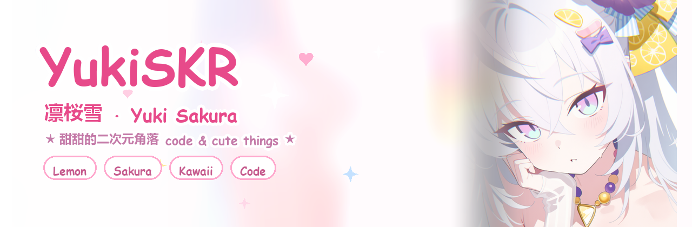

<!-- ============================================================
     🍋 YukiSKR · 凛桜雪 的 GitHub 主页（卡通 / 二次元 / 活泼风）
     使用方法：把这个 README.md 和 assets 文件夹一起放进 用户名/用户名 仓库根目录
     要改文字直接改中文部分；把 YukiSKR 换成你的用户名即可
     ============================================================ -->

<!-- ============ 顶部背景大图（由你给的插画生成） ============ -->
<div align="center">



<a href="https://github.com/YukiSKR">
  
</a>

<br/>

<!-- 小徽章：颜色都是粉粉的，可以随便改 hex 色号 -->


</div>

---

<!-- ============ 关于我 ============ -->
## 🎀 关于我

<table>
<tr>
<td width="34%" valign="middle">
  
</td>
<td valign="middle">

> 你好呀，我是 **凛桜雪（YukiSKR）** ❄️
> 一只住在代码里的雪之少女，喜欢甜甜的东西和好看的东西～

- 🍋 **最近沉迷**：写小工具、折腾好看的界面
- 🌸 **正在学习**：Python 🐍 · C/C++ · C# · Java · 前端动画
- 💬 **欢迎来聊**：二次元 / 游戏 / 脚本 / 界面美化
- 🎨 **小爱好**：画画、收集粉色系配色、听歌写代码
- ✨ **信条**：`把喜欢的东西，做成能跑起来的样子`

</td>
</tr>
</table>

```text
   /\_/\
  ( o.o )   喵～ 写代码的时候不要忘记喝水哦
   > ^ <
```

---

<!-- ============ 技能栈 ============ -->
## 💻 技能栈

<div align="center">

**主力武器**


**网页 & 小玩意**


**装备栏**


<br/>

<!-- 卡通小图标墙（skillicons） -->


</div>

---

<!-- ============ 小档案 / 萌度面板 ============ -->
## 🍰 萌度面板

```text
☕ 咖啡因浓度      ███████░░░  70%   「再来一杯就写完了」
🍋 柠檬汽水依存度  █████████░  90%   「冰块要多一点！」
🎀 可爱值          ██████████ 100%   「这个不用测，本来就是」
🐛 打 bug 的耐心   ████░░░░░░  40%   「…明天再说吧」
😴 摸鱼指数        ██████░░░░  60%   「只是站起来看看窗外而已」
```

<div align="center">

**今日运势：** 🌸 小吉 · 适合 push 一次 · 记得写 commit message

</div>

---

<!-- ============ 项目 ============ -->
## 🚀 我的小项目

<div align="center">

<!-- 把 repo= 后面的仓库名换成你自己的；这两个卡片自动抓取仓库信息 -->
<a href="https://github.com/YukiSKR?tab=repositories">
  
</a>
<a href="https://github.com/YukiSKR?tab=repositories">
  
</a>

<p><i>✧ 更多仓库点上面的卡片进去逛逛吧 ✧</i></p>

</div>

---

<!-- ============ 数据统计 ============ -->
## 📊 数据统计

<div align="center">


<br/>


<br/>


</div>

<!-- 想要会动的小蛇吃方块？在仓库里加一个 .github/workflows/snake.yml 生成
     snake.svg 之后，把下面这行的注释去掉就行

-->

---

<!-- ============ 每日一言 ============ -->
## ✍️ 每日一言

<div align="center">

> 「 雪のように、静かに降り積もる —— 像雪一样，安静地堆积起来 」
>
> 今天也辛苦啦，记得对自己好一点 🍮

</div>

---

<!-- ============ 找到我 ============ -->
## 💌 找到我

<div align="center">

<a href="https://github.com/YukiSKR">
  
</a>
<a href="https://t.me/YukiSKR">
  
</a>
<a href="https://x.com/_AyaKa47_">
  
</a>
<a href="https://discord.com/users/MChara">
  
</a>

<br/><br/>

<!-- 底部彩带：也是用你给的插画做的 -->


<sub>🍋 感谢你来玩 · Thanks for visiting · またね～ 🎀</sub>

</div>
